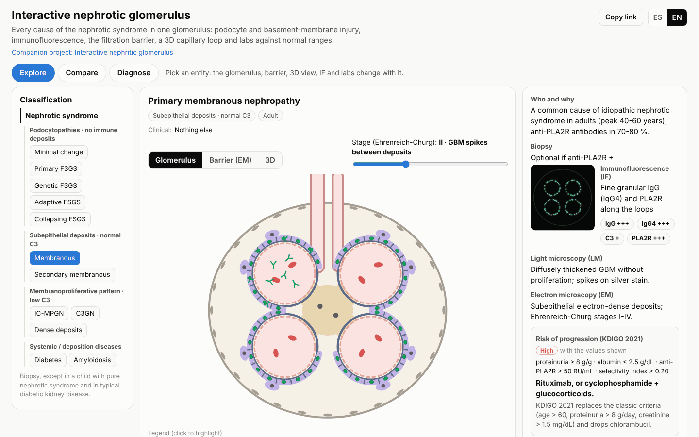

# Glomérulo nefrótico interactivo · Interactive nephrotic glomerulus

Every cause of the **nephrotic syndrome** drawn in **one glomerulus**: how each disease injures the podocyte and the basement membrane, what the biopsy shows, why some proteinuria is selective and some is not, and how the labs differ from normal. Three views of the same lesion (glomerulus, filtration barrier at electron-microscopy scale, rotatable 3D capillary loop), plus treatment courses, side-by-side comparison and unnamed cases to diagnose.

Companion to the [Interactive nephritic glomerulus](https://ferasmed-dev.github.io/nephritic-glomerulus/).

**Live demo:** https://ferasmed-dev.github.io/nephrotic-glomerulus/ · English: https://ferasmed-dev.github.io/nephrotic-glomerulus/?lang=en



> Teaching tool · not for clinical use.

## What it shows

- **12 entities** in four branches:
  - **Podocytopathies** (no immune deposits): minimal change disease, primary FSGS, genetic FSGS, secondary adaptive FSGS (hyperfiltration), collapsing FSGS (HIV)
  - **Subepithelial deposits** (normal C3): primary (anti-PLA2R) and secondary membranous nephropathy
  - **Membranoproliferative pattern** (low C3): immune-complex MPGN, C3 glomerulonephritis, dense deposit disease
  - **Systemic / deposition diseases**: diabetic kidney disease, AL amyloidosis
- **Three views of the lesion**
  - *Glomerulus*: schematic cross-section with the vascular pole. Each lesion is its own layer: foot-process effacement (diffuse or segmental), segmental sclerosis with hyalinosis and synechia, collapse with podocyte hyperplasia, subepithelial deposits with spikes (Ehrenreich-Churg stages I-IV on a slider), subendothelial and mesangial deposits, double contours, dense deposits, Kimmelstiel-Wilson nodules, afferent + efferent arteriolar hyalinosis, amyloid. A "What is happening?" panel lights up each step.
  - *Barrier (EM)*: one strip of capillary wall (endothelium, GBM with its negative charges, foot processes and slit diaphragms) with plasma proteins (β2-microglobulin, albumin, transferrin, IgG) that try to cross it. Crossing probabilities come from the sieve model below.
  - *3D*: a rotatable capillary loop (drag, arrow keys, zoom). Interdigitating foot processes from two podocytes with slits between them, or a fused sheet when effaced; hide the podocytes to see subepithelial deposits and spikes.
- **Barrier sieve** (Model): sieving coefficients of the four proteins against the normal barrier on a log scale, the selectivity index (IgG/transferrin clearance) and the composition of the filtrate.
- **From lesion to clinical picture**: proteinuria → albumin → edema, cholesterol, antithrombin (thrombotic risk), IgG (infections), with the verdict *pure* / *impure* nephrotic syndrome or *nephrotic-range proteinuria without the syndrome*.
- **KDIGO 2021 risk card** for membranous nephropathy, recalculated from the labs on screen.
- **Time models** (Model):
  - *Podocytopathies on treatment*: proteinuria over 16 weeks of prednisone (MCD, primary and genetic FSGS) or RAAS blockade + SGLT2 inhibitor (adaptive FSGS), with the steroid-resistance time point (4 weeks in children, 16 in adults).
  - *Membranous nephropathy*: anti-PLA2R titre, proteinuria and albumin over 24 months, with a slider for the month rituximab starts, a no-treatment counterfactual and the baseline titre (low titres remit spontaneously).
- **Labs against normal ranges**: 24 parameters, each on its normal band with an arrow and a label, so abnormal values never rely on colour alone. Child-specific limits for proteinuria and blood pressure.
- **Three modes**: *Explore*, *Compare* (only the findings that tell two entities apart are highlighted) and *Diagnose* (reproducible random cases checked by a rule engine that explains its reasoning; the biopsy is shown only when it would be done).
- Spanish (default) and English, light and dark themes, keyboard-usable, every chart has a data-table view, reduced-motion support.

## Curriculum fit

For **students and teachers at any Spanish medical faculty**. The topic belongs to the shared national core (Orden ECI/332/2008):

| | |
|---|---|
| Topic | Nephrotic syndrome and the glomerulopathies that cause it: podocytopathies, membranous nephropathy, MPGN/C3 glomerulopathy, diabetic kidney disease, amyloidosis |
| Module | Formación clínica humana (with Morfología, estructura y función for the filtration barrier and the pathology) |
| Typical subjects | Nefrología / Patología médica, Fisiopatología, Anatomía patológica, Fisiología (filtration barrier), Pediatría (nephrotic syndrome in children) |
| MIR | Highly relevant: syndrome vs nephrotic-range proteinuria, selective proteinuria, fatty casts, minimal change disease in children (no biopsy), anti-PLA2R and the rule of thirds, thrombotic risk in membranous, low C3 + normal C4 in C3 glomerulopathy, Kimmelstiel-Wilson nodules, Congo red |

Topic metadata for catalogues is in [`curriculum.json`](curriculum.json).

## For teachers

Every scenario has a deep link you can project or share. Add `&lang=en` for English. "Copy link" in the app copies the exact state on screen.

| Link | Scenario |
|---|---|
| [`?preset=nino-edema-palpebral`](https://ferasmed-dev.github.io/nephrotic-glomerulus/?preset=nino-edema-palpebral) | Child with periorbital edema: minimal change disease at presentation (pure nephrotic syndrome) |
| [`?preset=cambios-minimos-corticoides`](https://ferasmed-dev.github.io/nephrotic-glomerulus/?preset=cambios-minimos-corticoides) | Same child after 3 weeks of prednisone: complete remission |
| [`?preset=barrera-selectiva`](https://ferasmed-dev.github.io/nephrotic-glomerulus/?preset=barrera-selectiva) | Barrier view of minimal change: albumin crosses, IgG does not |
| [`?preset=pedicelos-3d`](https://ferasmed-dev.github.io/nephrotic-glomerulus/?preset=pedicelos-3d) | 3D loop with diffuse foot-process effacement |
| [`?preset=gesf-primaria`](https://ferasmed-dev.github.io/nephrotic-glomerulus/?preset=gesf-primaria) | Primary FSGS after 16 weeks of glucocorticoids: partial remission only |
| [`?preset=gesf-genetica`](https://ferasmed-dev.github.io/nephrotic-glomerulus/?preset=gesf-genetica) | Genetic FSGS: no response at week 6 → steroid-resistant |
| [`?preset=proteinuria-sin-sindrome`](https://ferasmed-dev.github.io/nephrotic-glomerulus/?preset=proteinuria-sin-sindrome) | Obese adult: nephrotic-range proteinuria with normal albumin (adaptive FSGS) |
| [`?preset=gesf-colapsante-vih`](https://ferasmed-dev.github.io/nephrotic-glomerulus/?preset=gesf-colapsante-vih) | Collapsing FSGS with HIV |
| [`?preset=membranosa`](https://ferasmed-dev.github.io/nephrotic-glomerulus/?preset=membranosa) | Primary membranous nephropathy at diagnosis (stage II, KDIGO high risk) |
| [`?preset=membranosa-estadios`](https://ferasmed-dev.github.io/nephrotic-glomerulus/?preset=membranosa-estadios) | Barrier view at stage I: move the stage slider from I to IV |
| [`?preset=membranosa-3d`](https://ferasmed-dev.github.io/nephrotic-glomerulus/?preset=membranosa-3d) | 3D loop with subepithelial deposits and spikes |
| [`?preset=membranosa-rituximab`](https://ferasmed-dev.github.io/nephrotic-glomerulus/?preset=membranosa-rituximab) | Month 12 after rituximab: anti-PLA2R negative, proteinuria falling |
| [`?preset=membranosa-sin-tratamiento`](https://ferasmed-dev.github.io/nephrotic-glomerulus/?preset=membranosa-sin-tratamiento) | Month 12 without immunosuppression, high titre: still nephrotic |
| [`?preset=membranosa-titulo-bajo`](https://ferasmed-dev.github.io/nephrotic-glomerulus/?preset=membranosa-titulo-bajo) | Low baseline titre, no treatment: spontaneous immunological remission |
| [`?preset=barrera-no-selectiva`](https://ferasmed-dev.github.io/nephrotic-glomerulus/?preset=barrera-no-selectiva) | Barrier view of membranous: IgG crosses too |
| [`?preset=membranosa-secundaria`](https://ferasmed-dev.github.io/nephrotic-glomerulus/?preset=membranosa-secundaria) | Secondary membranous (anti-PLA2R negative, look for the cause) |
| [`?preset=gnmp-vhc`](https://ferasmed-dev.github.io/nephrotic-glomerulus/?preset=gnmp-vhc) | Immune-complex MPGN with HCV and cryoglobulins |
| [`?preset=glomerulopatia-c3`](https://ferasmed-dev.github.io/nephrotic-glomerulus/?preset=glomerulopatia-c3) | C3 glomerulonephritis |
| [`?preset=depositos-densos`](https://ferasmed-dev.github.io/nephrotic-glomerulus/?preset=depositos-densos) | Dense deposit disease |
| [`?preset=nefropatia-diabetica`](https://ferasmed-dev.github.io/nephrotic-glomerulus/?preset=nefropatia-diabetica) | Diabetic kidney disease |
| [`?preset=amiloidosis`](https://ferasmed-dev.github.io/nephrotic-glomerulus/?preset=amiloidosis) | AL amyloidosis |
| [`?preset=cambios-minimos-vs-gesf`](https://ferasmed-dev.github.io/nephrotic-glomerulus/?preset=cambios-minimos-vs-gesf) | Compare: minimal change vs primary FSGS (with treatment-response chart) |
| [`?preset=sindrome-vs-proteinuria-nefrotica`](https://ferasmed-dev.github.io/nephrotic-glomerulus/?preset=sindrome-vs-proteinuria-nefrotica) | Compare: nephrotic syndrome vs nephrotic-range proteinuria |
| [`?preset=membranosa-primaria-vs-secundaria`](https://ferasmed-dev.github.io/nephrotic-glomerulus/?preset=membranosa-primaria-vs-secundaria) | Compare: primary vs secondary membranous |
| [`?preset=c3gn-vs-ddd`](https://ferasmed-dev.github.io/nephrotic-glomerulus/?preset=c3gn-vs-ddd) | Compare: the two C3 glomerulopathies |
| [`?preset=diabetes-vs-amiloidosis`](https://ferasmed-dev.github.io/nephrotic-glomerulus/?preset=diabetes-vs-amiloidosis) | Compare: diabetic kidney disease vs amyloidosis |
| [`?preset=quiz`](https://ferasmed-dev.github.io/nephrotic-glomerulus/?preset=quiz) | Diagnose mode; `?mode=quiz&case=<number>` opens the same case for the whole class |

Direct links also work: `?mode=explore&entity=<id>` with `mcd, fsgsPrimary, fsgsGenetic, fsgsAdaptive, fsgsCollapsing, mn, mnSecondary, mpgnIC, c3gn, ddd, diabetic, amyloid`, plus `&view=glom|barrier|3d`, `&stage=1-4`, `&week=` (podocytopathies), `&month=`, `&tx=` (or `tx=none`), `&pla2r=` (membranous), `&podo=0` (3D without podocytes).

## The model

All logic is in [`src/model.js`](src/model.js): pure functions, no DOM, tested in Node.

### Normal ranges

Approximate adult references (each laboratory has its own; the app says so).

| Parameter | Normal | Basis |
|---|---|---|
| Urine protein/creatinine | < 0.15 g/g adult, < 0.2 g/g child; nephrotic range ≥ 3.5 g/g adult, ≥ 2 g/g child | KDIGO 2021 (adults), KDIGO 2025 (children) |
| Selectivity index (IgG/transferrin clearance) | ≤ 0.1 selective, > 0.2 non-selective | Classic definition; > 0.20 is a KDIGO 2021 high-risk marker in MN |
| Albumin | 3.5-5.0 g/dL (< 2.5 marked: thrombotic risk) | Standard; KDIGO 2021 anticoagulation threshold in MN |
| Total cholesterol / triglycerides | < 200 / < 150 mg/dL | Standard |
| Antithrombin III | 80-120 % | Standard |
| Serum IgG | 700-1600 mg/dL | Common laboratory range |
| Hematuria | ≤ 3 red cells/field | Standard sediment cut-off |
| eGFR | ≥ 90 mL/min/1.73 m² | KDIGO G1 |
| Systolic BP | < 130 mmHg adult; < 115 mmHg school-age child | Adult guideline threshold; child ≈ 95th percentile (**Model**) |
| C3 / C4 | 90-180 / 10-40 mg/dL | Common laboratory ranges |
| Anti-PLA2R | < 14 RU/mL (ELISA); > 50 marked: high risk | Assay cut-off; KDIGO 2021 |
| HbA1c | 4.0-5.6 % | Standard (diabetes ≥ 6.5 %) |
| ANA, HBsAg, anti-HCV, HIV, cryoglobulins, C3NeF, monoclonal protein | Negative / index < 1 | |

A **nephrotic syndrome** needs nephrotic-range proteinuria **and** albumin < 3.0 g/dL; it is **pure** when there is no hematuria, hypertension or eGFR < 60.

### Filtration-barrier sieve (**Model**)

Two pathways in parallel:

```
θ(protein) = (1 − s) · size(r) · exp(−Q · z · (1 − c)) + s · (1 − r/11)²
size(r)    = 1 / (1 + exp((r − 3.0) / 0.18))
```

| Symbol | Meaning | Value |
|---|---|---|
| r | Stokes radius, nm | β2-microglobulin 1.6, albumin 3.6, transferrin 4.0, IgG 5.3 |
| z | relative anionic charge | 0.3, 1, 0.6, 0.1 |
| Q | charge penalty | 4 (tuned so that normal albumin θ ≈ 6·10⁻⁴) |
| c | loss of negative charge (0-1) | per entity |
| s | fraction of large non-selective defects | 10⁻⁵ normal; per entity |

| Entity | c | s | Selectivity index | Albumin θ vs normal |
|---|---|---|---|---|
| Normal | 0 | 10⁻⁵ | 0.01 | 1× |
| Minimal change | 0.8 | 4·10⁻⁴ | **0.04 (selective)** | 25× |
| Primary FSGS | 0.6 | 0.004 | 0.35 | 14× |
| Genetic FSGS | 0.5 | 0.003 | 0.34 | 9× |
| Adaptive FSGS | 0.25 | 0.003 | 0.44 | 5× |
| Collapsing FSGS | 0.6 | 0.008 | 0.46 | 17× |
| Membranous (primary / secondary) | 0.3 | 0.006 / 0.005 | 0.51 / 0.49 | 8× / 7× |
| IC-MPGN | 0.3 | 0.005 | 0.49 | 7× |
| C3GN, DDD | 0.3 | 0.004 | 0.46 | 6× |
| Diabetic | 0.5 | 0.004 | 0.39 | 10× |
| AL amyloidosis | 0.3 | 0.008 | 0.54 | 9× |

Loss of charge alone lets albumin through but not IgG (selective); structural defects let IgG through too (non-selective). In the barrier animation each protein's crossing probability is θ × 30 (capped at 1) so that rare events can be seen.

### Podocytopathies on treatment (**Model**)

```
UPCR(t) = floor + (u0 − floor) · exp(−max(0, t − lag) / τ)        t in weeks
albumin = 4.2 − (4.2 − albumin0) · UPCR/u0
```

| Entity | Treatment | lag | τ | floor | Result |
|---|---|---|---|---|---|
| Minimal change | prednisone | 0.3 wk | 0.35 wk | 0.1 g/g | complete remission in week 2 (steroid-sensitive) |
| Primary FSGS | prednisone | 2 wk | 5 wk | 2.5 g/g | 2.9 g/g at week 16: partial remission only |
| Genetic FSGS | prednisone | — | — | baseline | no response |
| Adaptive FSGS | ACE inhibitor/ARB + SGLT2 inhibitor | 0.5 wk | 3 wk | 60 % of baseline | 4.9 → 2.95 g/g, no remission |

Remission thresholds: children complete ≤ 0.2 g/g, partial < 2 g/g with albumin ≥ 3 g/dL; adults complete < 0.3 g/g, partial ≤ 3.5 g/g and ≥ 50 % reduction. Steroid resistance: no complete remission after 4 weeks (children) or 16 weeks (adults) of full-dose prednisone.

### Membranous nephropathy course (**Model**)

```
k_spont = 0.12 · exp(−T0/40) /month          (spontaneous fall, slower at high titres)
after rituximab (lag 0.5 month): T falls at 0.6 /month
U_target = 0.15 + (u0 − 0.15) · min(1, T/T0)
dU/dt = (U_target − U) / 4 months
```

Euler integration, dt = 0.05 month. Anti-PLA2R shown with a 1 RU/mL floor (assay limit).

| Scenario (T0 = 125 RU/mL, UPCR 8.5 g/g) | Anti-PLA2R < 14 | Partial remission | Complete remission |
|---|---|---|---|
| Rituximab month 1 | month 5.3 | month 7.3 | month 19.8 |
| Rituximab month 6 | month 10.3 | month 12 | not within 24 months |
| No immunosuppression | never | never | never |
| No immunosuppression, T0 = 20 RU/mL | month 5 | month 17.3 | not within 24 months |

### KDIGO 2021 risk in membranous nephropathy

`mnRisk()` encodes the simplified KDIGO 2021 categories: **very high** (rapid unexplained loss of function), **high** (eGFR < 60, proteinuria > 8 g/day, or nephrotic proteinuria with albumin < 2.5 g/dL, anti-PLA2R > 50 RU/mL or selectivity index > 0.20), **moderate** (nephrotic proteinuria, normal eGFR, no high-risk marker), **low** (normal eGFR, proteinuria < 3.5 g/day or albumin > 3.0 g/dL). The typical patient at diagnosis is high risk; at month 12 after rituximab, low risk.

### Rule engine

`classify()` reproduces the usual reasoning: nephrotic-range proteinuria with normal albumin → not a syndrome (adaptive FSGS with obesity); monoclonal protein or Congo red → amyloidosis; long-standing diabetes with retinopathy and no hematuria → diabetic kidney disease (no biopsy); low C3 → MPGN pattern (low C4, HCV or cryoglobulins → immune-complex MPGN; normal C4 → C3 glomerulopathy, dense deposits / lipodystrophy / drusen → DDD, otherwise C3GN); anti-PLA2R positive → primary membranous; HIV → collapsing FSGS; child: family history or steroid resistance → genetic FSGS, otherwise minimal change (treated without biopsy); adult: biopsy decides (subepithelial deposits with negative PLA2R → secondary membranous; normal LM → minimal change; segmental sclerosis → primary FSGS). The tests check that it recovers every entity from its typical findings and from 800 generated cases.

## Presets: expected results

| Preset | Expected |
|---|---|
| `nino-edema-palpebral` | UPCR 9.0 g/g, albumin 1.5 g/dL, edema +++, selectivity 0.04, pure nephrotic syndrome |
| `cambios-minimos-corticoides` | Week 3: UPCR 0.10 g/g, albumin 4.2 g/dL, no edema → complete remission |
| `gesf-primaria` | Week 16: UPCR 2.9 g/g, albumin 3.5 g/dL → partial remission, steroid-resistant |
| `gesf-genetica` | Week 6: UPCR 5.5 g/g, albumin 2.4 g/dL → no remission |
| `proteinuria-sin-sindrome` | UPCR 4.9 g/g with albumin 3.8 g/dL and no edema → nephrotic-range proteinuria without syndrome |
| `membranosa` | UPCR 8.5 g/g, albumin 1.9 g/dL, anti-PLA2R 125 RU/mL → KDIGO high risk |
| `membranosa-rituximab` | Month 12: anti-PLA2R 1 RU/mL, UPCR 1.2 g/g, albumin 3.9 g/dL → KDIGO low risk |
| `membranosa-sin-tratamiento` | Month 12: anti-PLA2R 117 RU/mL, UPCR 8.2 g/g, albumin 2.0 g/dL |
| `membranosa-titulo-bajo` | Month 12: anti-PLA2R 8.4 RU/mL, UPCR 4.9 g/g |
| `membranosa-secundaria` | Anti-PLA2R 4.5 RU/mL (negative), UPCR 6.5 g/g |
| `gnmp-vhc` | C3 55, C4 5.5 mg/dL (both low), anti-HCV +, cryoglobulins + |
| `glomerulopatia-c3`, `depositos-densos` | C3 low (35 / 16.5 mg/dL), C4 normal |
| `nefropatia-diabetica` | HbA1c 8.7 %, no hematuria, UPCR 4.8 g/g |
| `amiloidosis` | Monoclonal protein +, UPCR 9.5 g/g, no hematuria, low-normal BP |

## Known simplifications

- The glomerulus is a schematic cross-section of four capillary loops, not histology; "focal" (only some glomeruli) cannot be shown in one glomerulus and is explained in the text.
- The sieve is a two-pathway teaching model (**Model**), not a fitted two-pore model; tubular reabsorption is described, not simulated.
- The time courses are teaching models (**Model**) tuned to the classic clinical course, not fitted to patient data; real response times vary widely.
- Each entity is shown at its typical presentation; real patients vary (adult minimal change disease, C3NeF-negative DDD, membranous with normal-range anti-PLA2R…). Minimal change disease is modelled in its pediatric form; the adult form appears in the rule engine.
- Normal ranges are approximate; children use their own proteinuria and blood-pressure limits only.

## Layout

```
index.html          page shell
src/model.js        data, normal ranges, sieve, time models, KDIGO risk, rule engine, presets (pure)
src/i18n.js         ES + EN text
src/glomerulus.js   SVG glomerulus and IF / Congo red panel
src/barrier.js      EM-scale barrier and protein particles
src/view3d.js       3D capillary loop (canvas, no libraries)
src/charts.js       dependency-free SVG charts with hover and table view
src/ui.js           DOM, modes, deep links (exposes window.__sim)
src/styles.css      light/dark styles
tests/model.test.js node:test suite
curriculum.json     topic metadata
```

## Run locally

No build step:

```bash
python3 -m http.server 8000
# open http://localhost:8000/
```

## Tests

```bash
npm test   # node --test (Node 18+)
```

GitHub Actions runs the tests on every push (`.github/workflows/test.yml`).

## Deploy (GitHub Pages)

Settings → Pages → Deploy from a branch → `main` / `(root)`. The site appears at `https://ferasmed-dev.github.io/nephrotic-glomerulus/`.

## References

- KDIGO 2021 Clinical Practice Guideline for the Management of Glomerular Diseases. *Kidney Int* 2021;100(4S):S1-S276 (nephrotic syndrome, MCD, FSGS, membranous risk categories and treatment, C3 glomerulopathy).
- KDIGO 2025 Clinical Practice Guideline for the Management of Nephrotic Syndrome in Children. *Kidney Int* 2025;107(5S).
- KDIGO 2022 Clinical Practice Guideline for Diabetes Management in Chronic Kidney Disease. *Kidney Int* 2022;102(5S).
- Trautmann A, et al. IPNA clinical practice recommendations for the diagnosis and management of children with steroid-resistant nephrotic syndrome. *Pediatr Nephrol* 2020;35:1529-61.
- Beck LH Jr, et al. M-type phospholipase A2 receptor as target antigen in idiopathic membranous nephropathy. *N Engl J Med* 2009;361:11-21.
- Ronco P, et al. Membranous nephropathy. *Nat Rev Dis Primers* 2021;7:69.
- Fervenza FC, et al. Rituximab or cyclosporine in the treatment of membranous nephropathy (MENTOR). *N Engl J Med* 2019;381:36-46.
- Hengel FE, et al. Autoantibodies targeting nephrin in podocytopathies. *N Engl J Med* 2024;391:422-33.
- D'Agati VD, et al. Pathologic classification of focal segmental glomerulosclerosis: a working proposal (Columbia classification). *Am J Kidney Dis* 2004;43:368-82.
- Smith RJH, et al. C3 glomerulopathy — understanding a rare complement-driven renal disease. *Nat Rev Nephrol* 2019;15:129-43.
- FDA approvals of iptacopan (March 2025) and pegcetacoplan (July 2025) for C3 glomerulopathy.
- Tervaert TWC, et al. Pathologic classification of diabetic nephropathy. *J Am Soc Nephrol* 2010;21:556-63.
- International Study of Kidney Disease in Children. Nephrotic syndrome in children: prediction of histopathology from clinical and laboratory characteristics at time of diagnosis. *Kidney Int* 1978;13:159-65.
- Deen WM, Lazzara MJ, Myers BD. Structural determinants of glomerular permeability. *Am J Physiol Renal Physiol* 2001;281:F579-96.
- Farreras-Rozman. *Medicina Interna*, sección de Nefrología. Elsevier.
- Feehally J, Floege J, Tonelli M, Johnson RJ. *Comprehensive Clinical Nephrology*, 7th ed. Elsevier.

## License

[MIT](LICENSE) © 2026 Feras Elhissi
